# 🎮 Awesome Multimedia & Game Libraries

  
  
  
  
  
  

**A curated, production-ready directory of commercial SaaS game creation platforms and battle-tested open-source multimedia libraries.**  
*Specializing in DirectMedia hardware abstraction, modern graphics pipelines (Vulkan, DirectX, Metal, OpenGL, WebGPU), 3D spatial audio engines, and high-performance 2D/3D game engines.*

---

## 📑 Table of Contents

- [📊 Sector Overview & Market Dynamics](#-sector-overview--market-dynamics)
- [☁️ Commercial & SaaS Game Engines](#️-commercial--saas-game-engines)
- [🚀 Top Open-Source Multimedia & Game Libraries](#-top-open-source-multimedia--game-libraries)
- [🧩 Architectural Comparison Matrix](#-architectural-comparison-matrix)
- [🛠️ How to Contribute](#️-how-to-contribute)
- [⭐ Star History](#-star-history)
- [❤️ Support & Community](#️-support--community)
- [⚠️ Disclaimer](#️-disclaimer)

---

## 📊 Sector Overview & Market Dynamics

The global game development software and multimedia engine ecosystem is estimated at **$5.2 Billion in 2025–2026**, projected to accelerate at a compound annual growth rate (**CAGR of ~13.8%**) to surpass **$11.5 Billion by 2032**, powering an overarching interactive entertainment and real-time 3D simulation industry exceeding $280 Billion.

In terms of market structure, the industry exhibits **high concentration at the enterprise commercial tier**, forming an oligopoly dominated by Unity and Epic Games Unreal Engine across AAA console, PC, and mobile studios. Conversely, the indie, 2D, and hardware abstraction layer is **moderately fragmented and rapidly democratizing**, fueled by an explosion of developer momentum behind modular, royalty-free open-source technologies (notably Godot, Bevy, Raylib, and SDL3) that grant complete algorithmic sovereignty without vendor lock-in.

---

## ☁️ Commercial & SaaS Game Engines

The following table benchmarks leading commercial game creation platforms and hosted engine SaaS solutions. Entries are **sorted in descending order by company scale** (market capitalization / private valuation).

| 🏢 Platform & Service | 📈 Company Scale & Valuation | 💳 Starting Pricing | 🎁 Free Tier Limits & Free Trial Details | 🎯 Key Target & Capabilities |
| :--- | :--- | :--- | :--- | :--- |
| **[Roblox Studio](https://create.roblox.com)** | **~$28.4 Billion Valuation / Market Cap** *(NYSE: RBLX; ~$3.6B Annual Revenue)* | **Free to build & deploy**; monetization uses a 30% dev payout share (DevEx cash-out conversion rate fixed at $0.0035 per earned Robux). | **Free Forever Unlimited Plan**: Zero cost for desktop Studio editor, unlimited multiplayer game server hosting, automated global matchmaking, and cloud data store sync. | Social multiplayer games, live-ops sandbox experiences, and instant cross-platform distribution across PC, mobile, and consoles. |
| **[Unreal Engine](https://www.unrealengine.com)** *(Epic Games)* | **~$22.5 Billion Valuation** *(Private; ~$5.6B Annual Revenue)* | **5% gross royalty** strictly after a title exceeds **$1,000,000 in lifetime gross revenue**; non-gaming enterprise licenses start at **$1,850/seat/year**. | **Free Forever Creator Tier**: 100% royalty-free until reaching $1M gross game revenue. Grants complete access to full C++ source code on GitHub, Nanite, Lumen, and MetaHuman tools. | Photorealistic AAA 3D titles, virtual film production, broadcast VFX, and high-end architectural visualization. |
| **[Unity](https://unity.com)** *(Unity Software Inc.)* | **~$8.5 Billion Market Cap** *(NYSE: U; ~$2.1B Annual Revenue)* | **Unity Pro starts at $2,040/seat/year** (or $187/seat/month billed annually) once qualifying financial thresholds are surpassed. | **Unity Personal (Free Forever Plan)**: Free with complete core engine access for solo developers and small studios earning under **$200,000 in revenue/funding in the past 12 months**. | Mobile 2D/3D games, VR/AR spatial computing, and frictionless deployment across 20+ desktop, mobile, and web targets. |
| **[GameMaker](https://gamemaker.io)** *(Opera Ltd)* | **~$1.5 Billion Market Cap** *(NASDAQ: OPRA; ~$450M Annual Revenue)* | **Professional License starts at $99.99 one-time payment** for permanent non-console export rights; Enterprise tier at **$79.99/month** for console SDKs. | **Free Forever Non-Commercial Plan**: Free access to visual drag-and-drop (GML Visual) and code editor (GML Code) with direct publishing rights to the GX.games arcade. | 2D action games, rapid game jams, indie pixel-art hits (e.g., Undertale, Hotline Miami), and cross-platform desktop exports. |
| **[Buildbox](https://www.buildbox.com)** *(AppOnboard Inc.)* | **~$40.0 Million Total Funding** *(AppOnboard venture backing)* | **Buildbox Plus starts at $19.99/month** (or $149.00/year billed annually); Pro tier at **$49.99/month** (or $349.00/year) for custom monetization ad networks. | **Free Forever Plan**: 100% free with limits of 1 active game world, up to 10 assets, 2 custom JavaScript nodes, and mandatory Buildbox splash screen branding. | Visual no-code game creation, rapid hyper-casual mobile prototyping, and logic flow systems for non-programmers. |
| **[Construct 3](https://www.construct.net)** *(Scirra Ltd)* | **~$8.5 Million Annual Revenue** *(Scirra Ltd)* | **Individual Plan starts at $22.99/month** (or $139.99/year billed annually); Business Organization plan at **$44.99/month**. | **Free Forever Web Edition**: Full web-based editor access restricted to 50 event sheet events, 2 animation layers, 1 visual effect per layer, and non-commercial project usage. | Browser-native HTML5/WebGL game design, educational classrooms, 2D sprite logic, and instant browser-based game iteration. |

---

## 🚀 Top Open-Source Multimedia & Game Libraries

Below is an extensive collection of open-source multimedia abstraction layers, low-level APIs, and independent game engines. Entries are **sorted in descending order by GitHub Star Count** with live stargazer badges.

### 1. [Godot Engine](https://github.com/godotengine/godot) 
- **License**: MIT  
- **Language**: C++, GDScript, C#  
- **Description**: The industry's premier fully free and open-source 2D and 3D game engine. Godot offers a dedicated lightweight visual editor, node-and-scene composition architecture, built-in animation timeline, and modern Vulkan-based clustered rendering pipeline. Supports one-click exports to Windows, Linux, macOS, Android, iOS, and WebAssembly with zero royalties or revenue clawbacks.

### 2. [Bevy](https://github.com/bevyengine/bevy) 
- **License**: MIT / Apache-2.0  
- **Language**: Rust  
- **Description**: A refreshingly simple data-driven game engine built from the ground up in Rust. Features an ergonomic, blazing-fast Entity Component System (ECS) with automatic compile-time query safety, modular renderer utilizing WebGPU/WGPU, hot-reloading asset pipelines, and declarative scene hierarchies.

### 3. [Phaser](https://github.com/phaserjs/phaser) 
- **License**: MIT  
- **Language**: JavaScript / TypeScript  
- **Description**: The gold standard 2D HTML5 canvas and WebGL game framework for desktop and mobile web browsers. Powers tens of thousands of browser games with integrated physics engines (Arcade, Matter.js), sprite animation sheets, Web Audio wrappers, device input handlers, and camera control suites.

### 4. [Raylib](https://github.com/raysan5/raylib) 
- **License**: zlib  
- **Language**: C99  
- **Description**: A highly praised, beginner-friendly C library designed for enjoying video games programming. Requires zero external dependencies, provides over 600 straightforward procedural functions, and leverages OpenGL (1.1 through 4.3 and ES 2.0) with unified 2D and 3D drawing routines. Maintained with over 60 community language bindings (Python, Rust, Go, C#).

### 5. [Babylon.js](https://github.com/BabylonJS/Babylon.js) 
- **License**: Apache-2.0  
- **Language**: TypeScript / WebGL / WebGPU  
- **Description**: A powerful, beautiful, and deeply optimized 3D graphics rendering engine for the web. Includes full physically based rendering (PBR), node material graph editor, WebXR spatial headset integration, volumetric lighting, particle systems, and integrated Havok physics for web-based games.

### 6. [libGDX](https://github.com/libgdx/libgdx) 
- **License**: Apache-2.0  
- **Language**: Java / Kotlin  
- **Description**: A robust cross-platform Java game development framework established over a decade of production usage. Exposes unified abstractions for windowing, filesystem I/O, audio streaming, and OpenGL ES rendering across Windows, Linux, macOS, Android, iOS (via RoboVM), and WebAssembly (via TeaVM).

### 7. [Cocos2d-x](https://github.com/cocos2d/cocos2d-x) 
- **License**: MIT  
- **Language**: C++, Lua, JavaScript  
- **Description**: The legendary high-performance 2D game framework utilized by millions of developers for global hits like *Badland* and *Geometry Dash*. Provides scene management, skeletal animation (Spine/Armature), tilemap rendering, Box2D/Chipmunk physics, and optimized mobile rendering for iOS and Android.

### 8. [bgfx](https://github.com/bkaradzic/bgfx) 
- **License**: BSD-2-Clause  
- **Language**: C++  
- **Description**: Cross-platform, graphics API-agnostic rendering library engineered with a "Bring Your Own Engine" ethos. Abstracting Direct3D 11/12, Vulkan, Metal, WebGPU, and OpenGL, bgfx is deployed in professional game engines, visualization software, and AAA rendering pipelines worldwide.

### 9. [SDL (Simple DirectMedia Layer)](https://github.com/libsdl-org/SDL) 
- **License**: zlib  
- **Language**: C  
- **Description**: The industry's foundational multimedia abstraction layer with over 25 years of active engineering. Handles window context generation, keyboard, mouse, gamepad/haptics, spatial audio playback, and hardware graphics surfaces (OpenGL, Vulkan, Direct3D, Metal). Powers Valve's Steam client, countless emulators, and commercial game engines. SDL3 introduces native cross-platform GPU driver abstractions.

### 10. [GLFW](https://github.com/glfw/glfw) 
- **License**: zlib/libpng  
- **Language**: C99  
- **Description**: A lean, razor-focused cross-platform library dedicated purely to OpenGL, OpenGL ES, and Vulkan window creation, surface configuration, and low-latency input event dispatch. Supports modern Wayland and X11 on Linux, macOS Cocoa, and Windows Win32 without audio or image bloating.

### 11. [MonoGame](https://github.com/MonoGame/MonoGame) 
- **License**: MS-PL  
- **Language**: C# / .NET  
- **Description**: An open-source, battle-tested C# implementation of the Microsoft XNA 4.0 Application Framework. Celebrated as the backbone of award-winning titles including *Celeste*, *Stardew Valley*, *Carrion*, and *Streets of Rage 4*. Supports PC, mobile, and first-party game consoles (Nintendo Switch, PlayStation, Xbox).

### 12. [SFML](https://github.com/SFML/SFML) 
- **License**: zlib/libpng  
- **Language**: C++  
- **Description**: Simple and Fast Multimedia Library providing an ergonomic, object-oriented C++ API. Structured into five focused modules: System, Window, Graphics (2D hardware-accelerated sprites, text, and shaders), Audio (recording and spatialized playback), and Network (TCP/UDP sockets and HTTP). Active development centers on SFML 3 with modern C++17 paradigms.

### 13. [Sokol](https://github.com/floooh/sokol) 
- **License**: zlib  
- **Language**: C99  
- **Description**: Ultra-minimal, header-only C99 multi-platform libraries. Provides standalone modules for cross-platform 3D graphics wrapper (`sokol_gfx`), application lifecycle and input (`sokol_app`), low-latency audio buffer streaming (`sokol_audio`), and time management. Outstanding choice for WebAssembly emulators and hyper-lightweight native tools.

### 14. [Fyrox](https://github.com/FyroxEngine/Fyrox) 
- **License**: MIT  
- **Language**: Rust  
- **Description**: A full-featured 2D and 3D game engine written completely in native Rust, featuring a standalone visual scene editor. Highlights include a modern PBR renderer, HDR bloom, cascaded shadow maps, Rapier physics integration, built-in sound system, and hierarchical scene graph inspection.

### 15. [LÖVE (Love2D)](https://github.com/love2d/love) 
- **License**: zlib  
- **Language**: Lua / C++  
- **Description**: An awesome 2D game framework that pairs Lua with high-speed C++ backends (LuaJIT, SDL, OpenGL). Renowned for lightning-fast prototyping cycles, embedded Box2D physics, OpenAL spatial audio, and simple multiplatform game distribution.

### 16. [Stride](https://github.com/stride3d/stride) 
- **License**: MIT  
- **Language**: C# / .NET  
- **Description**: A modern, free, and open-source 2D and 3D game engine built entirely in C#. Equipped with a comprehensive graphical editor (Game Studio), photorealistic physically based rendering (PBR), VR capabilities, Bullet physics engine, and deep integration with Visual Studio and .NET 8+.

### 17. [Defold](https://github.com/defold/defold) 
- **License**: Developer-Friendly Source-Available (Free Forever)  
- **Language**: Lua / C++  
- **Description**: A turnkey 2D and 3D cross-platform game engine optimized for mobile, web, and desktop. Boasts a tiny engine binary footprint (~3MB runtime), responsive visual scene editor, zero-overhead Lua scripting, automated texture compression, and instantaneous WebAssembly export.

### 18. [Panda3D](https://github.com/panda3d/panda3d) 
- **License**: Modified BSD  
- **Language**: Python, C++  
- **Description**: A battle-tested 3D engine originally engineered by Disney and Carnegie Mellon University for commercial MMOs (*Toontown Online*, *Pirates of the Caribbean Online*). Features an automated Python-to-C++ binding layer, advanced shader pipeline, scene graph management, and Bullet/ODE physics bindings.

### 19. [OpenAL Soft](https://github.com/kcat/openal-soft) 
- **License**: LGPL-2.0+  
- **Language**: C / C++  
- **Description**: The industry reference software implementation of the OpenAL 3D spatial audio API. Delivers realistic 3D acoustic environments with distance attenuation, doppler shift, HRTF binaural 3D headphone virtualization, multi-channel surround output (5.1, 7.1), and environmental reverberation via EFX extensions.

### 20. [Allegro 5](https://github.com/liballeg/allegro5) 
- **License**: zlib  
- **Language**: C  
- **Description**: A veteran cross-platform game programming library offering an intuitive C interface. Features hardware-accelerated 2D bitmap manipulation, shader management, event queues, TTF font rendering, video playback, and multi-channel audio streaming across Windows, Linux, macOS, iOS, and Android.

---

## 🧩 Architectural Comparison Matrix

| Layer Category | Representative Libraries | Core Purpose | Typical Language Stack | Developer Control Level |
| :--- | :--- | :--- | :--- | :--- |
| **Hardware Abstraction Layer (HAL)** | `SDL3`, `GLFW`, `Sokol` | Window creation, surface allocation, input devices, raw audio buffers | C99, C | 🎛️ Maximum (BYO graphics pipeline) |
| **Graphics Agnostic Backends** | `bgfx`, `WGPU` | Cross-platform GPU render dispatch (DirectX, Vulkan, Metal) | C++, Rust | ⚙️ Very High (Custom render graph) |
| **Ergonomic Multimedia Frameworks** | `Raylib`, `SFML`, `Allegro` | Built-in 2D/3D shapes, image loading, sound playback, font drawing | C99, C++ | ⚖️ High (Code-first structure) |
| **Component Game Frameworks** | `MonoGame`, `Phaser`, `LÖVE` | Scene management, sprite batches, 2D physics, animation | C#, JS/TS, Lua | 📦 Moderate (Framework boundaries) |
| **Full Turnkey Game Engines** | `Godot`, `Bevy`, `Unreal`, `Unity` | Visual editors, integrated asset pipelines, physics, particle graphs | C++, GDScript, Rust, C# | 🚀 Batteries-Included (Turnkey workflow) |

---

## 🛠️ How to Contribute

Contributions are warmly welcomed! Help keep this ecosystem index fresh and comprehensive:

1. **Fork the repository** to your GitHub account.
2. **Create a descriptive feature branch** (`git checkout -b add-my-library`).
3. **Add or edit entries** adhering strictly to the existing formatting:
   - Provide the project name, official website, and GitHub repository link.
   - For open-source projects, include the star badge pointing to `/stargazers`.
   - Provide exact license, primary language, and factual capability summaries.
4. **Submit a Pull Request** with a brief summary explaining the addition.

---

## ⭐ Star History

---

## ❤️ Support & Community

Thank you for exploring and bookmarking **Awesome Multimedia & Game Libraries**! 🌟

If this curated technical resource has saved you development time or assisted your engine architecture research, please consider supporting the project:

- ⭐ **Star this repository** to improve visibility for the game dev community!
- 🍴 **Fork and contribute** new libraries, frameworks, and engine updates.
- 📢 **Share with fellow game engineers** on Twitter/X, Reddit (`r/gamedev`), and Discord.
- ☕ **Sponsor or Buy a Coffee**: Back continuous curation, automated checks, and maintenance via the [GitHub Sponsor Dashboard](https://github.com/sponsors/ishandutta2007). Every bit of support is deeply appreciated!

---

## ⚠️ Disclaimer

- This directory is a **community-curated index** provided for informational purposes; inclusion does not constitute a formal endorsement.
- Multimedia frameworks and game engines differ fundamentally in architecture and abstraction level:
  - **SDL and GLFW** are pure windowing/hardware abstraction layers requiring you to provide your own rendering logic.
  - **Raylib and SFML** supply batteries-included immediate and retained drawing functions without imposing full engine conventions.
  - **Godot, Unity, and Unreal** provide complete turnkey suites featuring graphical scene editors and dedicated asset pipelines.
- Verify software licenses, commercial royalty structures, and platform driver dependencies (DirectX 12 on Windows, Metal on Apple, Wayland/Vulkan on Linux) against your project's specific distribution requirements before deploying to production.

---

**Built with passion for game developers, graphics engineers, and real-time multimedia creators.**  
*Empowering creative coders across the open-source and indie gaming ecosystem.*

